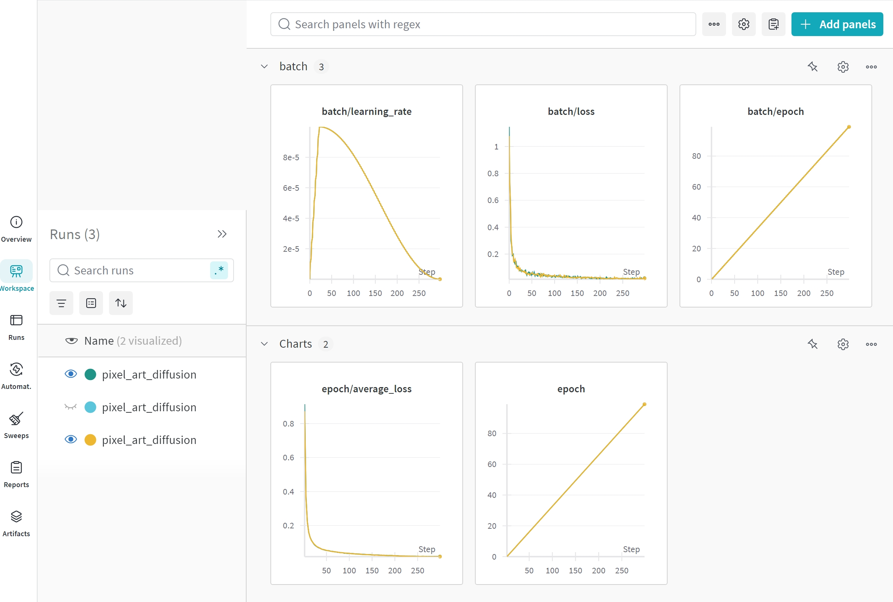
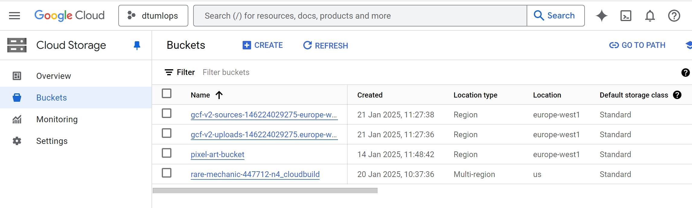
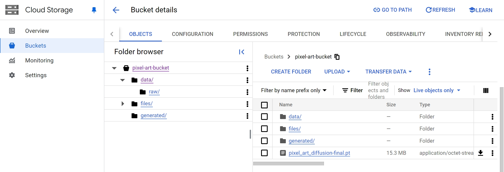
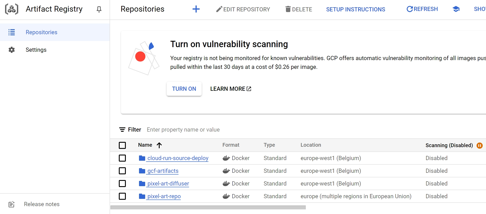
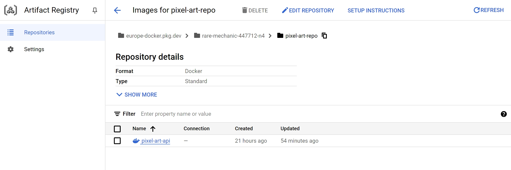
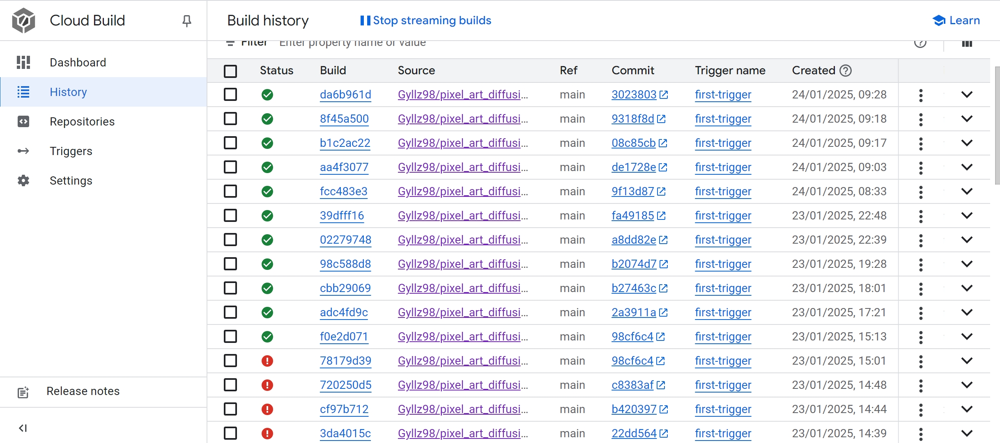

# Exam template for 02476 Machine Learning Operations

This is the report template for the exam. Please only remove the text formatted as with three dashes in front and behind
like:

```--- question 1 fill here ---```

Where you instead should add your answers. Any other changes may have unwanted consequences when your report is
auto-generated at the end of the course. For questions where you are asked to include images, start by adding the image
to the `figures` subfolder (please only use `.png`, `.jpg` or `.jpeg`) and then add the following code in your answer:

```markdown

```

In addition to this markdown file, we also provide the `report.py` script that provides two utility functions:

Running:

```bash
python report.py html
```

Will generate a `.html` page of your report. After the deadline for answering this template, we will auto-scrape
everything in this `reports` folder and then use this utility to generate a `.html` page that will be your serve
as your final hand-in.

Running

```bash
python report.py check
```

Will check your answers in this template against the constraints listed for each question e.g. is your answer too
short, too long, or have you included an image when asked. For both functions to work you mustn't rename anything.
The script has two dependencies that can be installed with

```bash
pip install typer markdown
```

## Overall project checklist

The checklist is *exhaustive* which means that it includes everything that you could do on the project included in the
curriculum in this course. Therefore, we do not expect at all that you have checked all boxes at the end of the project.
The parenthesis at the end indicates what module the bullet point is related to. Please be honest in your answers, we
will check the repositories and the code to verify your answers.

### Week 1

* [x] Create a git repository (M5)
* [x] Make sure that all team members have write access to the GitHub repository (M5)
* [x] Create a dedicated environment for you project to keep track of your packages (M2)
* [x] Create the initial file structure using cookiecutter with an appropriate template (M6)
* [x] Fill out the `data.py` file such that it downloads whatever data you need and preprocesses it (if necessary) (M6)
* [x] Add a model to `model.py` and a training procedure to `train.py` and get that running (M6)
* [x] Remember to fill out the `requirements.txt` and `requirements_dev.txt` file with whatever dependencies that you are using (M2+M6)
* [x] Remember to comply with good coding practices (`pep8`) while doing the project (M7)
* [x] Do a bit of code typing and remember to document essential parts of your code (M7)
* [x] Setup version control for your data or part of your data (M8)
* [x] Add command line interfaces and project commands to your code where it makes sense (M9)
* [x] Construct one or multiple docker files for your code (M10)
* [x] Build the docker files locally and make sure they work as intended (M10)
* [x] Write one or multiple configurations files for your experiments (M11)
* [x] Used Hydra to load the configurations and manage your hyperparameters (M11)
* [x] Use profiling to optimize your code (M12)
* [x] Use logging to log important events in your code (M14)
* [x] Use Weights & Biases to log training progress and other important metrics/artifacts in your code (M14)
* [ ] Consider running a hyperparameter optimization sweep (M14)
* [ ] Use PyTorch-lightning (if applicable) to reduce the amount of boilerplate in your code (M15)

### Week 2

* [x] Write unit tests related to the data part of your code (M16)
* [x] Write unit tests related to model construction and or model training (M16)
* [x] Calculate the code coverage (M16)
* [x] Get some continuous integration running on the GitHub repository (M17)
* [x] Add caching and multi-os/python/pytorch testing to your continuous integration (M17)
* [x] Add a linting step to your continuous integration (M17)
* [x] Add pre-commit hooks to your version control setup (M18)
* [x] Add a continues workflow that triggers when data changes (M19)
* [x] Add a continues workflow that triggers when changes to the model registry is made (M19)
* [x] Create a data storage in GCP Bucket for your data and link this with your data version control setup (M21)
* [x] Create a trigger workflow for automatically building your docker images (M21)
* [x] Get your model training in GCP using either the Engine or Vertex AI (M21)
* [x] Create a FastAPI application that can do inference using your model (M22)
* [x] Deploy your model in GCP using either Functions or Run as the backend (M23)
* [x] Write API tests for your application and setup continues integration for these (M24)
* [x] Load test your application (M24)
* [ ] Create a more specialized ML-deployment API using either ONNX or BentoML, or both (M25)
* [x] Create a frontend for your API (M26)

### Week 3

* [x] Check how robust your model is towards data drifting (M27)
* [x] Deploy to the cloud a drift detection API (M27)
* [x] Instrument your API with a couple of system metrics (M28)
* [x] Setup cloud monitoring of your instrumented application (M28)
* [x] Create one or more alert systems in GCP to alert you if your app is not behaving correctly (M28)
* [ ] If applicable, optimize the performance of your data loading using distributed data loading (M29)
* [x] If applicable, optimize the performance of your training pipeline by using distributed training (M30)
* [x] Play around with quantization, compilation and pruning for you trained models to increase inference speed (M31)

### Extra

* [ ] Write some documentation for your application (M32)
* [ ] Publish the documentation to GitHub Pages (M32)
* [x] Revisit your initial project description. Did the project turn out as you wanted?
* [ ] Create an architectural diagram over your MLOps pipeline
* [x] Make sure all group members have an understanding about all parts of the project
* [x] Uploaded all your code to GitHub

## Group information

### Question 1
> **Enter the group number you signed up on <learn.inside.dtu.dk>**
>
> Answer:

MLOPS 41

### Question 2
> **Enter the study number for each member in the group**
>
> Example:
>
> *sXXXXXX, sXXXXXX, sXXXXXX*
>
> Answer:

s233353, s195849, s180351

### Question 3
> **A requirement to the project is that you include a third-party package not covered in the course. What framework**
> **did you choose to work with and did it help you complete the project?**
>
> Recommended answer length: 100-200 words.
>
> Example:
> *We used the third-party framework ... in our project. We used functionality ... and functionality ... from the*
> *package to do ... and ... in our project*.
>
> Answer:

We utilized the Hugging Face Diffusers library, an advanced third-party package, to generate high-quality pixel art images in our project. This framework provided essential tools and functionality, including Denoising Diffusion Probabilistic Models (DDPMscheduler), UNet2DModel, and optimization.get_scheduler. These components played a crucial role in various stages of the project, such as model denoising, training, and managing the learning rate for optimization. By leveraging these features, we were able to implement sophisticated machine learning techniques to enhance the quality and detail of our generated pixel art. The Diffusers library significantly streamlined complex processes, ensuring efficiency and precision in our workflow. Ultimately, it helped us meet the project's technical and artistic requirements.


## Coding environment

> In the following section we are interested in learning more about you local development environment. This includes
> how you managed dependencies, the structure of your code and how you managed code quality.

### Question 4

> **Explain how you managed dependencies in your project? Explain the process a new team member would have to go**
> **through to get an exact copy of your environment.**
>
> Recommended answer length: 100-200 words
>
> Example:
> *We used ... for managing our dependencies. The list of dependencies was auto-generated using ... . To get a*
> *complete copy of our development environment, one would have to run the following commands*
>
> Answer:

To effectively manage dependencies in our project, we updated both requirements.txt and pyproject.toml in parallel with adding libraries to our code. This approach ensured a synchronized and organized way to track and manage the necessary packages. 

To replicate our environment, follow these steps:

Step 1. Clone our repository to your local machine.
Step 2. Create a new, blank virtual environment to isolate the project dependencies.
Step 3. Run 'pip install -e .' within the project directory. This command will install the dependencies listed in 'pyproject.toml' and link the local project for development.

This method ensures all required packages and versions are correctly installed, making it straightforward for collaborators to set up their environment and maintain consistency across development workflows.


### Question 5

> **We expect that you initialized your project using the cookiecutter template. Explain the overall structure of your**
> **code. What did you fill out? Did you deviate from the template in some way?**
>
> Recommended answer length: 100-200 words
>
> Example:
> *From the cookiecutter template we have filled out the ... , ... and ... folder. We have removed the ... folder*
> *because we did not use any ... in our project. We have added an ... folder that contains ... for running our*
> *experiments.*
>
> Answer:

We initialized our project using the cookiecutter template and filled out all the standard folders, ensuring a well-organized project structure. Additionally, we incorporated a '.dvc' folder for data version control, allowing us to efficiently manage datasets and track changes throughout the project. In the root directory, we added a 'cloudbuild.yaml' file to configure continuous integration and deployment using Google Cloud Platform (GCP). Furthermore, we included a '.ruff_cache' folder to enable automated code checks during pull requests to GitHub, ensuring consistent code quality and adherence to project standards. These modifications enhanced the functionality of the template while maintaining its core structure, enabling seamless collaboration and streamlined development processes tailored to our project’s specific requirements.

### Question 6

> **Did you implement any rules for code quality and format? What about typing and documentation? Additionally,**
> **explain with your own words why these concepts matters in larger projects.**
>
> Recommended answer length: 100-200 words.
>
> Example:
> *We used ... for linting and ... for formatting. We also used ... for typing and ... for documentation. These*
> *concepts are important in larger projects because ... . For example, typing ...*
>
> Answer:

We implementedcode quality and formatting rules using 

- Ruff for linting and formatting
- mypy for static type checking
- Pre-commit hooks to enforce these standards

This can be seen in our GitHub workflow and it automatically run these checks on every pull request, ensuring consistent code quality.

These practices are crucial in larger projects because they prevent technical debt, improve code readability, and catch potential errors early. Type checking helps prevent runtime errors, while consistent formatting makes collaboration smoother. Documentation and typing act as built-in code documentation, making the codebase more maintainable and easier for new team members to understand.

## Version control

> In the following section we are interested in how version control was used in your project during development to
> corporate and increase the quality of your code.

### Question 7

> **How many tests did you implement and what are they testing in your code?**
>
> Recommended answer length: 50-100 words.
>
> Example:
> *In total we have implemented X tests. Primarily we are testing ... and ... as these the most critical parts of our*
> *application but also ... .*
>
> Answer:

We implemented four test files: 'data', 'model', 'train', and 'api'.

- Data: Tested if the data path exists, verified the correct number and format of images in the third label.
- Model: Checked if the model checkpoint exists, ensured proper model initialization, and validated that generated samples had the correct output shape.
- Training: Confirmed the training directory points to the correct model directory and successfully tested training on a dataset subset with one epoch.
- API: Verified the app starts successfully, ran a load test, and ensured image generation from the model works as expected.


### Question 8

> **What is the total code coverage (in percentage) of your code? If your code had a code coverage of 100% (or close**
> **to), would you still trust it to be error free? Explain you reasoning.**
>
> Recommended answer length: 100-200 words.
>
> Example:
> *The total code coverage of code is X%, which includes all our source code. We are far from 100% coverage of our **
> *code and even if we were then...*
>
> Answer:

Our total code coverage is at exaclty 50%, which is not nearly enough for us to trust that it is error or bug free. Our highest code coverage percentage for the individual file outside of init, is cloud_function.py at 68% which is responsible for loading the model from GCP and communicationg with the cloud to get samples and visualize them in addition to storing them. The lowest code coverage percentage is 23% for generate_sample.py which is responsible for taking a model and generate samples. From the coverage report, it is clear that additional tests are needed to get 100% code coverage, but even then, it is still difficult to fully trust that the code will be error free as the complexity of the tests depends on our ability to test for edge-cases. 

### Question 9

> **Did you workflow include using branches and pull requests? If yes, explain how. If not, explain how branches and**
> **pull request can help improve version control.**
>
> Recommended answer length: 100-200 words.
>
> Example:
> *We made use of both branches and PRs in our project. In our group, each member had an branch that they worked on in*
> *addition to the main branch. To merge code we ...*
>
> Answer:

Our workflow utilized branches and pull requests for version control. The '.yaml' files show multiple workflows triggered on both push to the main branch and 'pull_request' to the main branch. This approach allows team members to work on separate branches, making independent changes without directly modifying the main branch.

Pull requests serve as a critical code review mechanism. Before merging any changes into the main branch, our workflows run comprehensive checks including unit tests, type checking (mypy), code linting (Ruff), and data synchronization tests across different operating systems and Python versions. 
This ensures code quality, catches potential issues early, and maintains the integrity of the main branch by requiring all checks to pass before merging.

The pre-commit CI workflow further enhances our version control by automatically checking and potentially fixing code formatting and style before commits are finalized.

### Question 10

> **Did you use DVC for managing data in your project? If yes, then how did it improve your project to have version**
> **control of your data. If no, explain a case where it would be beneficial to have version control of your data.**
>
> Recommended answer length: 100-200 words.
>
> Example:
> *We did make use of DVC in the following way: ... . In the end it helped us in ... for controlling ... part of our*
> *pipeline*
>
> Answer:

We used DVC to manage data in our project, which included 89,000 images. To optimize storage and efficiency, we archived the dataset into 'archive.zip' before integrating it with DVC. This setup enabled robust version control, allowing us to track changes and updates to the data seamlessly. 

By leveraging the GitHub-DVC workflow, we automated the synchronization of data changes, ensuring the data directory stayed up-to-date across the team. DVC significantly improved our project's data management by streamlining collaboration, reducing redundancy, and enabling precise rollbacks to previous data versions when necessary. 

This ensured consistency and reliability throughout our pipeline, making it easier to maintain and update the dataset efficiently.


### Question 11

> **Discuss you continuous integration setup. What kind of continuous integration are you running (unittesting,**
> **linting, etc.)? Do you test multiple operating systems, Python  version etc. Do you make use of caching? Feel free**
> **to insert a link to one of your GitHub actions workflow.**
>
> Recommended answer length: 200-300 words.
>
> Example:
> *We have organized our continuous integration into 3 separate files: one for doing ..., one for running ... testing*
> *and one for running ... . In particular for our ..., we used ... .An example of a triggered workflow can be seen*
> *here: <weblink>*
>
> Answer:

We have organized our continuous integration into 5 separate workflow files, each handling a distinct aspect of our testing and deployment pipeline:
The first workflow handles unit testing (tests.yaml) across multiple operating systems (Ubuntu, Windows, macOS) and Python versions (3.10, 3.11). It utilizes pip caching for efficient dependency management and runs coverage reports through pytest.
The second workflow (codecheck.yaml) manages code quality through Ruff for linting and formatting, along with mypy for type checking. Like our testing workflow, it runs on multiple OS/Python combinations with caching enabled.
The third workflow (cml_data.yaml) focuses on our data pipeline, validating our data processing across platforms. It handles Google Cloud authentication and DVC data pulling to ensure our data processing remains consistent in dimensionality and amount.
For documentation, we have a dedicated workflow (docs.yaml) that automatically deploys our MkDocs documentation when changes are pushed to main. However, for better CI long term a check should be added to make sure that the documentation is actually updated.
Finally, our pre-commit workflow (pre_commit.yaml) enforces code quality standards before commits and can automatically fix formatting issues.
All workflows utilize GitHub Actions' matrix testing capabilities for cross-platform compatibility and dependency caching to optimize execution time. An example of our testing workflow can be seen [here](https://github.com/Gyllz98/pixel_art_diffusion/actions/runs/12949125106/job/36119190985), which demonstrates our comprehensive approach to ensuring code quality and reliability.

## Running code and tracking experiments

> In the following section we are interested in learning more about the experimental setup for running your code and
> especially the reproducibility of your experiments.

### Question 12

> **How did you configure experiments? Did you make use of config files? Explain with coding examples of how you would**
> **run a experiment.**
>
> Recommended answer length: 50-100 words.
>
> Example:
> *We used a simple argparser, that worked in the following way: Python  my_script.py --lr 1e-3 --batch_size 25*
>
> Answer:

We configured experiments using both Hydra config files and Typer CLI. Our main configuration uses Hydra's configs/config.yaml, with CLI support through Typer:

Using Hydra config override:
```bash
python train.py optimizer.params.lr=1e-4 training.batch_size=32
```

Using Typer CLI:
```bash
python -m pixel_art_diffusion.train train-model --run-name="experiment_1" --num-epochs=100 --label-subset=[3]
```

Both approaches are integrated in our codebase (see train.py), allowing flexible experiment configuration while maintaining reproducibility through version-controlled configs.

The combination gives us structured config management with Hydra while preserving simple CLI accessibility through Typer.

### Question 13

> **Reproducibility of experiments are important. Related to the last question, how did you secure that no information**
> **is lost when running experiments and that your experiments are reproducible?**
>
> Recommended answer length: 100-200 words.
>
> Example:
> *We made use of config files. Whenever an experiment is run the following happens: ... . To reproduce an experiment*
> *one would have to do ...*
>
> Answer:

We prioritized experimental reproducibility through a comprehensive configuration management system. We created detailed YAML config files that captured all critical parameters and settings, including model architecture specifications, training hyperparameters, data paths, and Weights & Biases (wandb) logging configurations. These files were managed using Hydra, which provided a robust framework for handling configurations.
When an experiment was initiated, our system automatically logged the complete configuration state, including any command-line overrides, ensuring that every aspect of the experiment was documented. The config files also stored random seeds for both PyTorch and NumPy to guarantee deterministic behavior. Additionally, we maintained version control of our codebase using Git, with each experiment tagged with its corresponding commit hash.

### Question 14

> **Upload 1 to 3 screenshots that show the experiments that you have done in W&B (or another experiment tracking**
> **service of your choice). This may include loss graphs, logged images, hyperparameter sweeps etc. You can take**
> **inspiration from [this figure](figures/wandb.png). Explain what metrics you are tracking and why they are**
> **important.**
>
> Recommended answer length: 200-300 words + 1 to 3 screenshots.
>
> Example:
> *As seen in the first image when have tracked ... and ... which both inform us about ... in our experiments.*
> *As seen in the second image we are also tracking ... and ...*
>
> Answer:

The screenshots show training metrics from my diffusion model experiments tracked in Weights & Biases. I'm tracking:

Batch-level metrics:

- Learning rate: Monitors optimizer behavior and learning schedule
- Loss: Shows model convergence
- Epochs: Tracks training progress

Epoch-level metrics:

- Average loss: Indicates overall training stability
- Epoch count: Shows training duration

These metrics are important because they help identify training issues early, verify the model is learning properly, and ensure hyperparameters like learning rate are appropriately tuned. The smooth downward trend in loss curves and stable learning rate decay suggest successful training. But as we have spend the vast majority of the time on cloud, api, and CI/CD we did not run many experiments. Aditionally, we did prototyping in a notebook locally until training was stable.



### Question 15

> **Docker is an important tool for creating containerized applications. Explain how you used docker in your**
> **experiments/project? Include how you would run your docker images and include a link to one of your docker files.**
>
> Recommended answer length: 100-200 words.
>
> Example:
> *For our project we developed several images: one for training, inference and deployment. For example to run the*
> *training docker image: `docker run trainer:latest lr=1e-3 batch_size=64`. Link to docker file: <docker.io/darius0429/pixel-art-app>*
>
> Answer:

We implemented Docker containerization for both our training and API scripts to ensure consistent environments and easy deployment. The process begins with building the Docker image using our Dockerfile located in the dockerfiles directory. The command docker build -t pixel-art-app:latest -f dockerfiles/api.dockerfile . creates an image tagged as 'pixel-art-app:latest', encapsulating all necessary dependencies and configurations.
To run the containerized application, users simply execute docker run -p 8080:8080 pixel-art-app, which maps port 8080 from the container to the host machine, making the application accessible via localhost. This containerization approach ensures consistent behavior across different environments and simplifies deployment procedures.
For accessing the backend we maintained a direct Python script (src/run_app.py) that allows users to run a frontend.

### Question 16

> **When running into bugs while trying to run your experiments, how did you perform debugging? Additionally, did you**
> **try to profile your code or do you think it is already perfect?**
>
> Recommended answer length: 100-200 words.
>
> Example:
> *Debugging method was dependent on group member. Some just used ... and others used ... . We did a single profiling*
> *run of our main code at some point that showed ...*
>
> Answer:

We implemented extensive logging throughout our codebase to facilitate effective debugging and issue identification. By strategically placing logging statements at critical points in our scripts, we could track the execution flow and quickly identify failing components. These logging statements served as enhanced print statements, providing detailed information about variable states and execution paths.
For performance optimization, we utilized PyTorch's built-in profiling tools to analyze both our training and inference (generate_sample) scripts. This profiling helped us identify computational bottlenecks, memory usage patterns, and areas requiring optimization. The analysis revealed valuable insights about GPU utilization, batch processing efficiency, and potential areas for performance improvements, allowing us to make targeted optimizations to enhance overall system performance.

## Working in the cloud

> In the following section we would like to know more about your experience when developing in the cloud.

### Question 17

> **List all the GCP services that you made use of in your project and shortly explain what each service does?**
>
> Recommended answer length: 50-200 words.
>
> Example:
> *We used the following two services: Engine and Bucket. Engine is used for... and Bucket is used for...*
>
> Answer:

- Bucket: We use Bucket to store our data, model, and generated images for drift detection.
- Functions: We made a cloud Function to load our model from the bucket. We also made one that does different tasks related to datadrifting such as pushing and pulling generated images.
- Artifact Registry: Holds our docker images.
- Build + trigger: Everytime we time new code is pushed to main we rebuild the the api and deploy it.
- Run: As stated above our api is deployed with cloud Run so that you only need to launch the frontend locally.
- Monitoring: Monitors cpu usage among other things of our application.
- Alert: as generation is linked to uploading to the bucket we have set up an alert that triggers if too many uploads are made to the bucket within half an hour.
- Compute Engine: Our model is trained in a VM using L4 gpu.

### Question 18

> **The backbone of GCP is the Compute engine. Explained how you made use of this service and what type of VMs**
> **you used?**
>
> Recommended answer length: 100-200 words.
>
> Example:
> *We used the compute engine to run our ... . We used instances with the following hardware: ... and we started the*
> *using a custom container: ...*
>
> Answer:

The main way we used Google Cloud Platform's Compute Engine was for training our diffusion model. We provisioned a VM instance with an NVIDIA L4 GPU, which offers good performance for ML workloads while being cost-effective. The VM was configured with 16 vCPUs and 64GB RAM to handle our data preprocessing and training pipeline efficiently.
The instance was launched using our custom Docker container (defined in dockerfiles/train.dockerfile) which contained all necessary dependencies including PyTorch, diffusers library, and our training code. We used Debian as the base OS since it works well with ML workloads.
The configuration was automated through Cloud Build (as seen in cloudbuild.yaml), allowing us to consistently deploy our training environment. The L4 GPU proved sufficient for training our 16x16 pixel art model, offering a good balance between cost and performance for our relatively small image generation task.

### Question 19

> **Insert 1-2 images of your GCP bucket, such that we can see what data you have stored in it.**
> **You can take inspiration from [this figure](figures/bucket.png).**
>
> Answer:




### Question 20

> **Upload 1-2 images of your GCP artifact registry, such that we can see the different docker images that you have**
> **stored. You can take inspiration from [this figure](figures/registry.png).**
>
> Answer:




### Question 21

> **Upload 1-2 images of your GCP cloud build history, so we can see the history of the images that have been build in**
> **your project. You can take inspiration from [this figure](figures/build.png).**
>
> Answer:



### Question 22

> **Did you manage to train your model in the cloud using either the Engine or Vertex AI? If yes, explain how you did**
> **it. If not, describe why.**
>
> Recommended answer length: 100-200 words.
>
> Example:
> *We managed to train our model in the cloud using the Engine. We did this by ... . The reason we choose the Engine*
> *was because ...*
>
> Answer:

We successfully trained our pixel art diffusion model in Google Cloud Platform using Compute Engine. Our training pipeline was implemented through a multi-stage process using Cloud Build and custom Docker containers. First, we prepared our training container using train.dockerfile which included PyTorch, the diffusers library, and our custom training code. The training data was stored in a Cloud Storage bucket for efficient access.
We chose Compute Engine over Vertex AI because we needed fine-grained control over the GPU configuration and training environment. Our custom training pipeline required specific dependencies and data preprocessing steps that were easier to implement in a custom container. Additionally, Compute Engine provided better cost optimization for our use case, as we could precisely control when the GPU instance was running and shut it down automatically when training completed.
The flexibility of Compute Engine allowed us to implement features like automated model checkpointing to Cloud Storage and seamless integration with our monitoring stack, which proved essential for maintaining our MLOps pipeline.

## Deployment

### Question 23

> **Did you manage to write an API for your model? If yes, explain how you did it and if you did anything special. If**
> **not, explain how you would do it.**
>
> Recommended answer length: 100-200 words.
>
> Example:
> *We did manage to write an API for our model. We used FastAPI to do this. We did this by ... . We also added ...*
> *to the API to make it more ...*
>
> Answer:

We implemented a comprehensive API using FastAPI for our pixel art generation model. The API (api.py) features several key endpoints: /generate for creating new pixel art images, /samples for retrieving stored samples, /model_info for model status, and /data_drift for monitoring data quality.

We enhanced the API with production-ready features:

- Prometheus metrics tracking generation requests, memory usage, and latency
- Background task handling for storing generated samples
- Proper error handling and logging
- Data drift monitoring using Evidently AI
- Async context manager for model loading
- Streaming responses for image delivery
- Health check endpoint

All of which is intergrated in the cloud deployed api container.

### Question 24

> **Did you manage to deploy your API, either in locally or cloud? If not, describe why. If yes, describe how and**
> **preferably how you invoke your deployed service?**
>
> Recommended answer length: 100-200 words.
>
> Example:
> *For deployment we wrapped our model into application using ... . We first tried locally serving the model, which*
> *worked. Afterwards we deployed it in the cloud, using ... . To invoke the service an user would call*
> *`curl -X POST -F "file=@file.json"<weburl>`*
>
> Answer:

We successfully deployed our API using Google Cloud Run for scalable, serverless deployment. The deployment process is automated through our cloudbuild.yaml pipeline, which:
1. Builds the Docker container from api.dockerfile
2. Pushes it to Google Container Registry 
3. Deploys to Cloud Run with automatic scaling

The API is accessible at https://pixel-art-api-146224029275.europe-west1.run.app. Users can interact with it through:

1. Web Interface (Streamlit):
```bash
pixel-art-app
```
2. Direct API calls:
```bash
# Generate 4 pixel art images
curl -X POST "https://pixel-art-api-146224029275.europe-west1.run.app/generate?num_samples=4" -o generated_art.png

# Get model info
curl https://pixel-art-api-146224029275.europe-west1.run.app/model_info
```
Cloud Run automatically handles scaling based on demand, and we only pay for actual usage. The service integrates with Cloud Monitoring and Logging for observability.

### Question 25

> **Did you perform any unit testing and load testing of your API? If yes, explain how you did it and what results for**
> **the load testing did you get. If not, explain how you would do it.**
>
> Recommended answer length: 100-200 words.
>
> Example:
> *For unit testing we used ... and for load testing we used ... . The results of the load testing showed that ...*
> *before the service crashed.*
>
> Answer:

We conducted comprehensive load testing using Locust, simulating 100 concurrent users performing different API tasks. The test prioritized three main tasks:

1. Loading the page and model (highest priority)
2. Retrieving model information
3. Generating pixel art samples (most resource-intensive)

The load testing results showed interesting patterns in API performance under stress:

- Mean response time increased proportionally with user load
- The model generation endpoint showed the highest latency, as expected
- The API demonstrated good stability, never crashing despite the load
- Cloud Run's auto-scaling helped maintain service availability

The test results helped us identify potential bottlenecks and validate our deployment architecture. While response times increased under load, the service remained operational throughout the test, demonstrating the robustness of our Cloud Run deployment and the effectiveness of our async request handling.

For unit testing, we used pytest to test individual API endpoints and model functionality, ensuring reliable service operation.

### Question 26

> **Did you manage to implement monitoring of your deployed model? If yes, explain how it works. If not, explain how**
> **monitoring would help the longevity of your application.**
>
> Recommended answer length: 100-200 words.
>
> Example:
> *We did not manage to implement monitoring. We would like to have monitoring implemented such that over time we could*
> *measure ... and ... that would inform us about this ... behaviour of our application.*
>
> Answer:

We implemented Prometheus metrics in our API but didn't complete the cloud deployment of the monitoring stack due to time constraints. Our monitoring implementation includes:

- Request metrics: `pixel_art_generate_requests_total`
- Performance metrics: `pixel_art_generation_time_seconds`
- Resource usage: `pixel_art_memory_usage_bytes`
- Data drift monitoring using Evidently AI

While these metrics are accessible through the API's `/metrics` endpoint, we couldn't complete the deployment of a Prometheus sidecar container in Cloud Run to collect and store them long-term. With more time, we would have:

1. Deployed Prometheus alongside our API
2. Set up regular dashboard for visualization
3. Implemented alerts for anomalies

This would have enabled us to track model performance degradation, resource utilization patterns, and data drift over time, crucial for maintaining service quality and planning capacity.

## Overall discussion of project

> In the following section we would like you to think about the general structure of your project.

### Question 27

> **How many credits did you end up using during the project and what service was most expensive? In general what do**
> **you think about working in the cloud?**
>
> Recommended answer length: 100-200 words.
>
> Example:
> *Group member 1 used ..., Group member 2 used ..., in total ... credits was spend during development. The service*
> *costing the most was ... due to ... . Working in the cloud was ...*
>
> Answer:

We conducted our entire project within a single cloud environment, which provided a unified platform for our development and experimentation needs. The total cost of our cloud resources amounted to 5.44 USD, with the majority of expenses attributed to compute engine training, specifically the rental of an L4 GPU instance. This GPU utilization represented the most significant portion of our resource consumption and credit usage.
While working in the cloud environment presented certain challenges and proved to be time-consuming – particularly in terms of setup, configuration, and resource management – we gained valuable insights into its advantages for scalable applications. The experience helped us understand how cloud infrastructure can facilitate the deployment of large-scale systems, enable collaborative development, and provide flexible resource allocation despite the initial learning curve and operational overhead. This practical exposure to cloud computing gave us a deeper appreciation for its role in modern software development and machine learning workflows.

### Question 28

> **Did you implement anything extra in your project that is not covered by other questions? Maybe you implemented**
> **a frontend for your API, use extra version control features, a drift detection service, a kubernetes cluster etc.**
> **If yes, explain what you did and why.**
>
> Recommended answer length: 0-200 words.
>
> Example:
> *We implemented a frontend for our API. We did this because we wanted to show the user ... . The frontend was*
> *implemented using ...*
>
> Answer:

We implemented a streamlit frontend to the build and a datadrift monitoring system to the build with endpoint: "/data_drift".

### Question 29

> **Include a figure that describes the overall architecture of your system and what services that you make use of.**
> **You can take inspiration from [this figure](figures/overview.png). Additionally, in your own words, explain the**
> **overall steps in figure.**
>
> Recommended answer length: 200-400 words
>
> Example:
>
> *The starting point of the diagram is our local setup, where we integrated ... and ... and ... into our code.*
> *Whenever we commit code and push to GitHub, it auto triggers ... and ... . From there the diagram shows ...*
>
> Answer:


The starting point of the diagram is our local setup, where we integrated DVC for data management, Hydra for configuration, and the core model components (data.py, model.py, train.py) into our code.

Whenever we commit code, pre-commit hooks run first to check linting and code formatting. After pushing to GitHub, it automatically triggers our CI/CD workflows which include Unit tests (data, model, and API tests), Code quality checks (PEP8 and type checking), Coverage reporting and Dependabot checks for dependencies.

From there, if all checks pass, the diagram shows a build trigger that initiates the Docker image build and pushes it to the Container Registry in Google Cloud Platform.

>For the training flow:

- The training pipeline pulls data using DVC from Cloud Storage Runs the training with configurations from Hydra Logs metrics and model artifacts to Weights & Biases Model artifacts are stored back in Cloud Storage.

For the serving flow:
Cloud Run pulls the latest Docker image from Container Registry
It runs the FastAPI backend service
The Streamlit frontend interacts with this backend
When users generate images, they're stored back in Cloud Storage
The entire service is monitored through Cloud Monitoring with alerts set up

All components are connected through GCP, with Cloud Storage acting as a central hub for data, models, and generated images, while Cloud Run handles the serving infrastructure and Cloud Monitoring keeps track of system health.

### Question 30

> **Discuss the overall struggles of the project. Where did you spend most time and what did you do to overcome these**
> **challenges?**
>
> Recommended answer length: 200-400 words.
>
> Example:
> *The biggest challenges in the project was using ... tool to do ... . The reason for this was ...*
>
> Answer:

The most significant challenges in our project centered around cloud deployment and CI/CD infrastructure setup. Cloud configuration presented substantial difficulties due to complex service account permissions and obscure access policies. The cloud logging system provided poor visibility for debugging deployment issues, making it challenging to understand why deployments failed or behaved unexpectedly after having succeeded locally.
Our CI/CD pipeline faced severe performance challenges that significantly impacted development velocity:

- Docker builds were extremely slow without caching (which we attempted but couldn't successfully implement despite multiple approaches)
- Each failed workflow run resulted in 10+ minute setbacks
- Matrix testing across different OS/Python versions multiplied build times dramatically
- Code checks and pre-commit hooks added substantial overhead to every push
- Building containers with no cache regularly took 15-20 minutes

Infrastructure maintenance posed ongoing challenges throughout the project:

- DVC data pipeline required careful integration with cloud storage
- Cloud build triggers needed precise configuration with main branch pushes
- Service account access levels were often unclear and required trial-and-error
- Debugging cloud deployment issues was particularly difficult due to limited logging visibility
- Cloud storage permissions had to be carefully balanced between security and accessibility

The most time-consuming aspect was iterating on cloud configurations while dealing with permission issues and lengthy build times. Working around these limitations required careful planning of pushes to main and strategic use of branch development to minimize pipeline triggers. The lack of successful caching implementation meant we had to be extremely selective about when to trigger full rebuilds.
This experience emphasized the critical importance of early cloud infrastructure planning and the significant impact of build performance on development velocity. It also highlighted how seemingly simple cloud integrations can become complex when dealing with real-world security policies and access controls.

### Question 31

> **State the individual contributions of each team member. This is required information from DTU, because we need to**
> **make sure all members contributed actively to the project. Additionally, state if/how you have used generative AI**
> **tools in your project.**
>
> Recommended answer length: 50-300 words.
>
> Example:
> *Student sXXXXXX was in charge of developing of setting up the initial cookie cutter project and developing of the*
> *docker containers for training our applications.*
> *Student sXXXXXX was in charge of training our models in the cloud and deploying them afterwards.*
> *All members contributed to code by...*
> *We have used ChatGPT to help debug our code. Additionally, we used GitHub Copilot to help write some of our code.*
> Answer:

Student s233353 was in charge of building the docker images both for training and the api, integrating configuration experiments, profiling, setting up CI workflows for the git repo (pre-commit, code-check, dvc code sync, unittests), building the front end, data drift analysis and some parts of deploying it to cloud.

Student s195849 was in charge of everything GCP: Compute Engine training, Continous Deployment with Cloud Run/Build, Buckets (and in extension dvc), etc. Also finalized CI (pre-commit, code-Check, unittests). Also set-up the repo and wrote the model, training loop, and dataloader + set-up wandb logging. Also, did the documentation.

Student s180351 was in charge of developing the back end (FastAPI), creating unit testing for the data, model, training and api together with code coverage. Also load testing our application and instrumented system metrics for the API. 